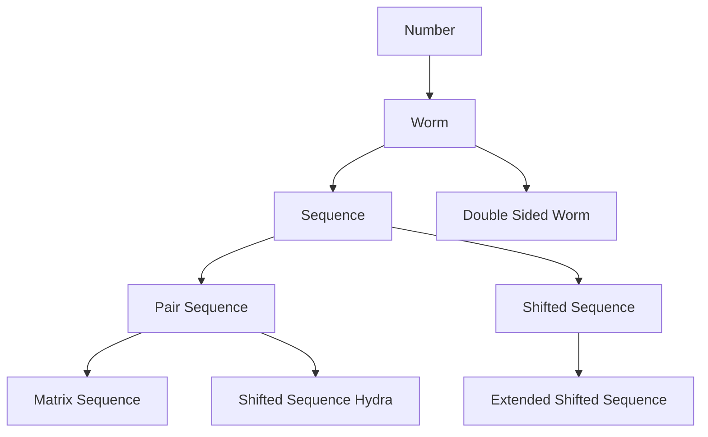

# Notation Stats

## Extention Tree

## Complexity

The complexity of a notation is an estimation of how long its definition is.

To calculate it, count tokens used for functions `expand`, `getLimit`, `isSucc`, and `isZero`. Inline functions and constants that are used once. Merge multiple functions with similar architecture.

> The tables below use the old counting method, which is no longer accurate.

### ≥ ω

| Ordinal | Notation | Complexity |
| - | - | - |
| ω | number | 30 |
| ω | unaryWorm | 55 |
| ω^2 | pairNumber | 60 |
| ω^ω | worm | 65 |
| ω^ω | indexArray | 100 |
| ω^ω | array | 115 |
| ω^ω | binaryArray | 155 |
| ω^ω^ω | doubleSidedWorm | 195 |

### ≥ ε0

| Ordinal | Notation | Complexity |
| - | - | - |
| ε0 | shortSequence | 125 |
| ε0 | pointerSequence | 140 |
| ε0 | sequence | 155 |
| ε0 | addressSequence | 160 |
| ε0 | hydra | 175 |
| ε0 | binaryShiftedSequence | 235 |
| ε0 | binaryTreeSequence | 280 |
| εω | wormSequence | 190 |
| εω | wormHydra | 195 |
| φ(ω,0) | pointerExtendedSequence | 145 |
| φ(ω,0) | extendedSequence | 175 |
| φ(ω,0) | treeSequence | 420 |
| Γ0 | shiftedSequence | 315 |
| Γ0 | shortShiftedSequence | 375 |

### ≥ ψ(Ωω)

| Ordinal | Notation | Complexity |
| - | - | - |
| ψ(Ωω) | sequenceHydra | 260 |
| ψ(Ωω) | addressPairSequence | 300 |
| ψ(Ωω) | hyperSequence | 300 |
| ψ(Ωω) | pointerPairSequence | 315 |
| ψ(Ωω) | pairSequence | 320 |
| ψ(Ωω) | hyperHydra | 370 |
| ψ(Λ) | extendedShiftedSequence | 490 |
| ψ(Mω) | shiftedSequenceHydra | 455 |
| ψ(T[ω]) | extendedSequenceHydra | 445 |
| ψ(T[1[0]<ω>0]) | pointerTrioSequence | 370 |
| ψ(T[1[0]<ω>0]) | addressTrioSequence | 390 |
| ψ(T[1[0]<ω>0]) | hyper^2Hydra | 515 |
| ψ(T[1[0]<ω>0]) | trioSequence | 535 |
| ψ(T[1[0]<ω>0]) | hyperSequenceHydra | 550 |

### ≥ ψ(Bω)

| Ordinal | Notation | Complexity |
| - | - | - |
| ψ(Bω) | pointerMatrixSequence | 515 |
| ψ(Bω) | addressMatrixSequence | 540 |
| ψ(Bω) | matrixSequence | 825 |

## Milestones

Least complex notation for each major milestone.

| Milestone | Notation | Complexity |
| - | - | - |
| ω | number | 30 |
| ω^ω | worm | 65 |
| ε0 | shortSequence | 125 |
| φ(ω,0) | pointerExtendedSequence | 145 |
| ψ(Ωω) | sequenceHydra | 260 |
| ψ(T[1[0]<ω>0]) | pointerTrioSequence | 370 |
| ψ(Bω) | matrixSequence | 515 |
